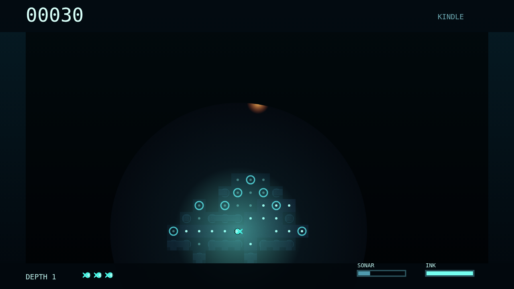
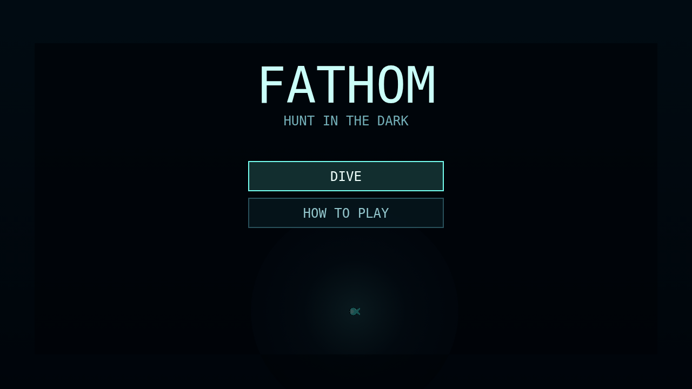

# Fathom

Fathom is a deep-sea maze chase where the safest route is never fully known. You
pilot a small glimmering forager through flooded trench corridors, grazing
plankton to brighten your glow while the maze remembers what you have found and
then swallows it back into darkness beyond your circular view.

Every dive is a balance between hunger and stealth. Eating plankton makes you
brighter, widens the window of remembered ground, and exposes more of the maze,
but that same light gives the Lanternjaw and Flarefish a stronger trail to hunt.
Sonar can flood corridors around corners, marking danger for a moment, while ink
buys a little silence when the walls start to close in.

Three predators read the dark in different ways. The Lanternjaw hides as an amber
glimmer until its jaws are lit, the Gloamfin answers sound with violet and orange
pings, and the Flarefish burns open the maze with a hot bloom before lunging at a
lock. A cleared depth is a brief breath before the next descent adds pressure.

